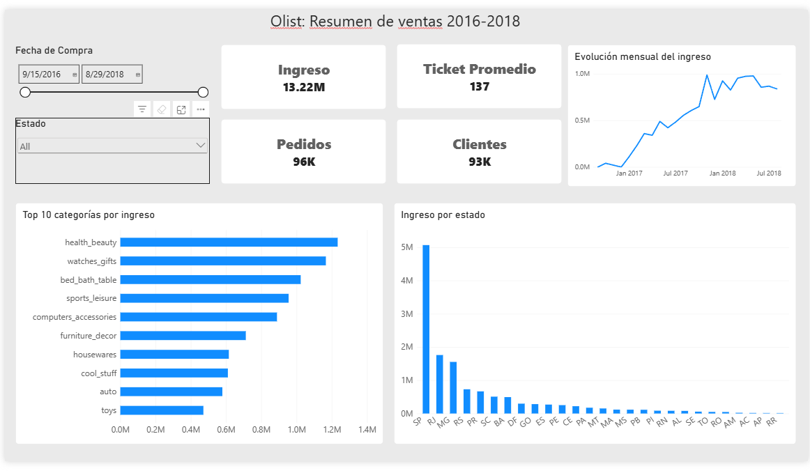

# Olist: análisis de ventas con SQL Server y Power BI | Sales Analysis with SQL Server and Power BI

[Español](#español) | [English](#english)

---

## Español

### Objetivo
Analizar las ventas de un e-commerce brasileño: responder preguntas de
negocio con SQL y presentar los resultados en un dashboard interactivo.

### Datos
Brazilian E-Commerce Public Dataset by Olist (Kaggle), ~100 mil pedidos (2016-2018).

### Flujo del proyecto
1. **Exploración y preguntas de negocio** en SQL Server (`sql/01` y `sql/02`).
2. **Vista `v_ventas`** que une pedidos, productos, clientes y categorías (`sql/03`).
3. **Dashboard en Power BI** conectado a la vista, con medidas en DAX.
4. **Validaciones** (`sql/04_validaciones.sql`): comparación de las métricas del dashboard contra consultas SQL.

### Decisiones de análisis
- Solo pedidos con estado `delivered`.
- Se excluyen septiembre y octubre de 2018 (datos incompletos).
- Ingreso = suma de `price` (sin flete).
- Categorías traducidas al inglés con la tabla oficial del dataset.
- Métricas del dashboard validadas contra consultas SQL.

> Nota: las consultas de `sql/02` no excluyen septiembre y octubre de 2018, por eso sus cifras pueden diferir ligeramente de las del dashboard.

### Hallazgos
- Ingreso total de 13.22M y ticket promedio de 137.
- São Paulo concentra ~38% del ingreso (5.07M).
- El ingreso mensual creció durante 2017 y se estabilizó entre 0.8M y 1.0M en 2018.
- Categorías líderes: health_beauty, watches_gifts y bed_bath_table.

### Herramientas
SQL Server (T-SQL), Power BI Desktop, DAX

### Cómo reproducirlo
Los CSV no están incluidos en el repositorio.
1. Descargar el dataset de [Kaggle](https://www.kaggle.com/datasets/olistbr/brazilian-ecommerce).
2. Importar los CSV a SQL Server (SSMS → Import Wizard).
3. Ejecutar los scripts de `sql/` en orden (01 → 04).
4. Abrir `powerbi/olist_dashboard.pbix` y actualizar la conexión a tu instancia.

---

## English

### Objective
Analyze the sales of a Brazilian e-commerce store: answer business questions
with SQL and present the results in an interactive dashboard.

### Data
Brazilian E-Commerce Public Dataset by Olist (Kaggle), ~100k orders (2016-2018).

### Project flow
1. **Exploration and business questions** in SQL Server (`sql/01` and `sql/02`).
2. **`v_ventas` view** joining orders, products, customers and categories (`sql/03`).
3. **Power BI dashboard** connected to the view, with DAX measures.
4. **Validations** (`sql/04_validaciones.sql`): dashboard metrics checked against SQL queries.

*(`v_ventas` and `04_validaciones.sql` are Spanish file names.)*

### Analysis decisions
- Delivered orders only.
- September and October 2018 excluded (incomplete data).
- Revenue = sum of `price` (excluding freight).
- Categories translated to English using the dataset's official table.
- Dashboard metrics validated against SQL queries.

> Note: the queries in `sql/02` do not exclude September and October 2018, so their figures may differ slightly from the dashboard.

### Findings
- Total revenue of 13.22M and average order value of 137.
- São Paulo accounts for ~38% of revenue (5.07M).
- Monthly revenue grew during 2017 and stabilized between 0.8M and 1.0M in 2018.
- Leading categories: health_beauty, watches_gifts and bed_bath_table.

### Tools
SQL Server (T-SQL), Power BI Desktop, DAX

### How to reproduce
The CSV files are not included in this repository.
1. Download the dataset from [Kaggle](https://www.kaggle.com/datasets/olistbr/brazilian-ecommerce).
2. Import the CSV files into SQL Server (SSMS → Import Wizard).
3. Run the scripts in `sql/` in order (01 → 04).
4. Open `powerbi/olist_dashboard.pbix` and update the connection to your instance.
